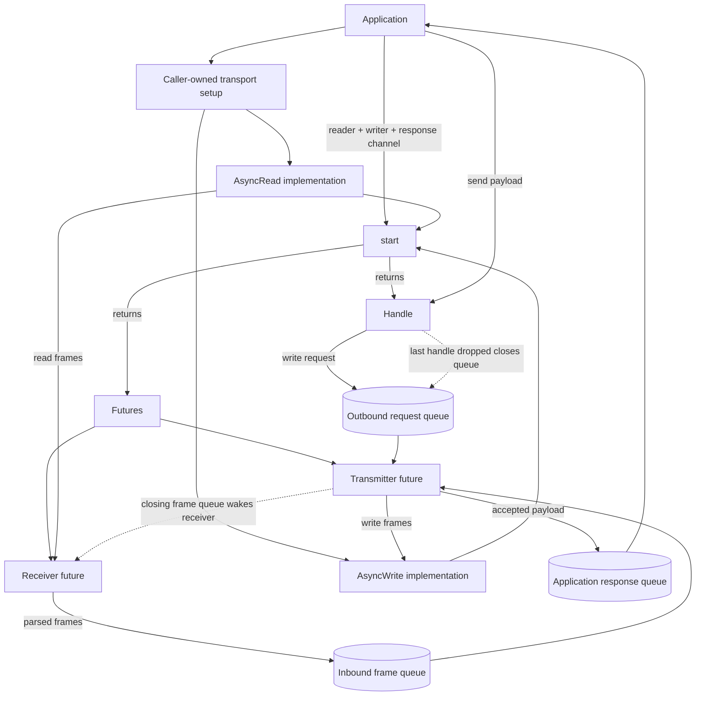
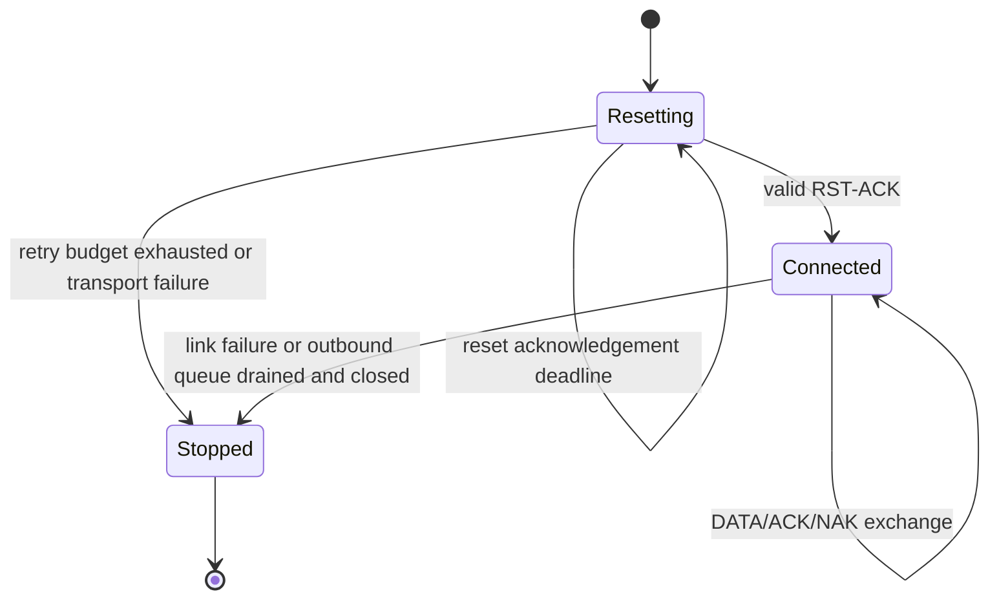
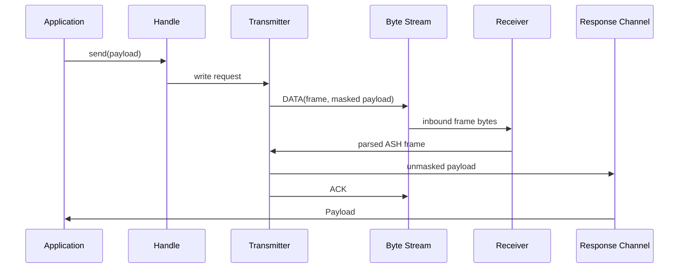
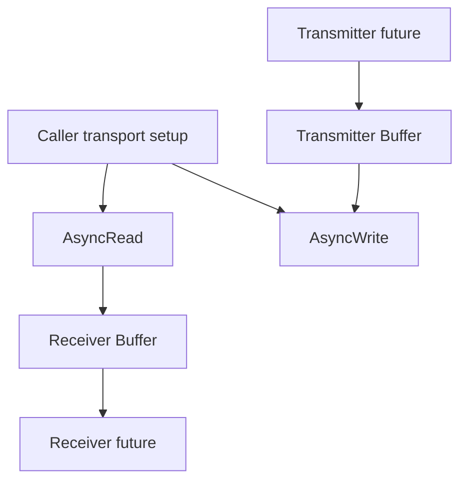
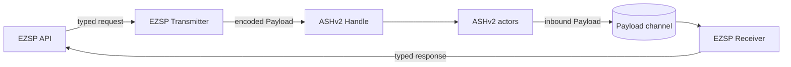
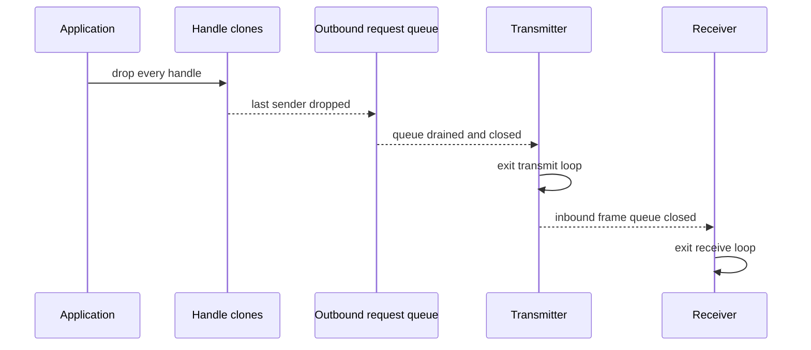

# ASHv2 Architecture

## Scope

This document describes the internal architecture of this crate as currently implemented.
The crate implements the host side of ASHv2 over caller-provided asynchronous byte streams.
The transport is commonly a serial link to an NCP, but the core architecture is independent of
how that stream is opened and configured.

## High-Level Runtime Structure

At runtime, the crate is centered around `start(...)`, which creates two asynchronous
actor futures:

- `Transmitter` owns the writer, both sequence counters, the transmit window, and link timers.
- `Receiver` owns the reader and forwards parsed frames and framing errors in wire order.

`start(reader, writer, response)` takes transport halves that the caller has already opened,
configured, and split. It returns `Handle`, the user-facing send handle, and a `Futures`
container with transmitter and receiver futures. The caller polls both concurrently on an
executor compatible with the transport. A dedicated frame queue lets the transmitter keep
handling incoming frames when the outbound request or application response queue is full.

## Core Modules and Responsibilities

- `src/actor/*`
  - `start(...)`, internal message bus, and caller-owned future lifecycle.
- `src/actor/receiver/buffer.rs`
  - Receive-side chunk buffering, byte scanning, control-byte handling, unstuffing, and frame parsing.
- `src/actor/transmitter/buffer.rs`
  - Transmit-side frame serialization, byte stuffing, frame termination, and asynchronous writes.
- `src/frame/*`
  - Frame data structures and binary conversion for `DATA`, `ACK`, `NAK`, `RST`, `RST-ACK`, `ERROR`.
- `src/frame/headers/*`
  - Bit-level header composition/parsing for `DATA`, `ACK`, `NAK`.
- `src/protocol/randomization.rs`
  - ASH payload randomization (masking).
- `src/protocol/stuffing.rs`
  - Byte stuffing and unstuffing around control bytes.
- `src/validate.rs`
  - CRC-16-IBM-3740 validation.
- `src/ezsp/*` (feature `ezsp`)
  - Optional adapters from typed EZSP frames to ASHv2 payloads and back.

## Connection and Future Lifecycle

On startup the transmitter sends `RST` and waits for a valid `RST-ACK` with ASH version 2.
The reset timer allows five retries. While waiting, the transmitter discards other incoming
frames and leaves application requests in their queue.

## Message Flow

### Outbound path (App -> NCP)

1. App calls `Handle::send(payload).await`.
2. `Handle` enqueues a write request with a oneshot for the result.
3. When the link is connected and the window has room, the transmitter takes the request. It
   assigns the next outbound frame number and the current inbound ACK number, masks the
   payload, and calculates its CRC.
4. The write buffer stuff-encodes the frame, appends `FLAG`, and writes and flushes the bytes
   within the transport write deadline.
5. The transmitter stores the written frame for retransmission and reports local write
   completion through the oneshot.

### Inbound path (NCP -> App)

1. The caller-provided `AsyncRead` implementation supplies inbound bytes.
2. The receiver buffer retains any unconsumed bytes between reads.
3. Receiver reads bytes until `FLAG`.
4. Receiver handles control bytes (`CANCEL`, `SUBSTITUTE`, `XON`, `XOFF`, `WAKE`) and un-stuffs payload bytes.
5. The receiver forwards parsed frames to the transmitter for CRC and sequence validation.
6. The transmitter processes the reverse ACK in valid `DATA`, `ACK`, and `NAK` frames.
7. For in-sequence `DATA`, it advances the receive counter and sends a standalone `ACK` after
   buffering the payload. While the response channel is full, it withholds acknowledgement of
   unbuffered payloads and advertises `nRdy`. Duplicates can carry valid ACKs and are discarded
   after acknowledgement processing.

## Async I/O Path

The core API is generic over separate Tokio `AsyncRead` and `AsyncWrite` implementations. It does
not depend on `serialport` or `async-serialport`, and does not open, configure, or split a serial
port. Those transport-specific operations belong to the calling application.

The transport values must be `Send + Unpin` and may contain borrows. The caller polls both
futures within the lifetime of any borrowed I/O. Both opaque return types capture both transport
type parameters, so spawning either future with `tokio::spawn` requires both types to be `'static`.

The receiver buffer reads chunks directly from the supplied reader and retains bytes after a
completed frame for the next read. The transmitter buffer writes fully encoded and stuffed frames
through the supplied writer. The two actor futures communicate through a bounded inbound frame
queue with capacity `TX_K`. The outbound request queue uses the configured response channel
capacity.

## Optional EZSP Integration

The `ezsp` feature enables the public `ashv2::ezsp` module and its optional `ezsp` and
`le-stream` dependencies. It does not change the core transport or actor API.

- `ashv2::ezsp::Transmitter` aliases `Handle`, whose `ezsp::Transmit` implementation encodes typed
  EZSP headers and parameters into `Payload`.
- `ashv2::ezsp::Receiver` owns the response channel's receiver, decodes each inbound `Payload`
  into a typed EZSP frame, and implements `ezsp::Receive`. The EZSP layer passes its negotiated
  protocol version into each receive call.

## Termination Path

Each `Handle` clone keeps the outbound request queue open. When it closes, the transmitter
drains queued writes before exiting. On link failure it closes the queue and resolves pending
requests with an I/O error. In both cases closing the inbound frame queue wakes the receiver,
including when it is waiting for serial input.

The caller continues driving both actor futures until they complete. After link failure, the
caller opens a fresh ASH session, renegotiates EZSP, and restores coordinator operation with
the existing persisted network. A new session starts with an empty window and sequence numbers
at zero. Previously written commands can have an unknown remote outcome.

## Frame Types and Purpose

| Frame | Header Pattern | Purpose | Key fields |
|---|---|---|---|
| `DATA` | bit7 = 0 | Carry protocol payload data | frame number (3 bits), retransmit flag, ACK number (3 bits), payload, CRC |
| `ACK` | `0b1000_xxxx` with type bits for ACK | Positive acknowledgement of received data | ACK number, `nRDY`, CRC |
| `NAK` | `0b1010_xxxx` with type bits for NAK | Negative acknowledgement, requests retransmit | ACK number, `nRDY`, CRC |
| `RST` | `0xC0` | Request reset / restart link establishment | fixed header, CRC |
| `RST-ACK` | `0xC1` | Confirm reset and report reset reason/version | protocol version, reset code, CRC |
| `ERROR` | `0xC2` | Signal protocol/link error | protocol version, error code, CRC |

### DATA header bit layout

- bits `6..4`: frame number (`u8`, lower 3 significant bits)
- bit `3`: retransmit flag
- bits `2..0`: ACK number (`u8`, lower 3 significant bits)

### ACK/NAK header bit layout

- ACK base: `0b1000_0000`
- NAK base: `0b1010_0000`
- bit `3`: `nRDY`
- bits `2..0`: ACK number (`u8`, lower 3 significant bits)

## Reliability and Retransmission Model

- The window holds `TX_K` frames in sequence order, from oldest to newest. The transmitter
  pauses application dequeuing when the window is full. The bounded request channel suspends
  additional senders until there is room.
- A valid ACK number lies between the oldest outstanding frame and the next outbound frame,
  inclusive, in modulo-eight order. It removes the whole acknowledged prefix.
- A NAK or expiry of the oldest frame's deadline schedules the unacknowledged suffix for
  retransmission in sequence order. The transmitter can process incoming acknowledgements
  between retries and skip frames already acknowledged.
- Retries keep the original frame number, refresh the reverse ACK field, and recompute the CRC.
  Each completed write refreshes that frame's deadline.
- A frame can be sent three times, including its original write. Retry exhaustion ends the
  session with a timeout. Control and data writes share the configured transport write deadline.
- Deadlines use the monotonic clock and an executor-independent timer. On native targets,
  `futures-timer` wakes the actor from a shared timer thread.
- The host refreshes `nRdy` every 500 ms while the response channel remains full and sends a
  readiness ACK as soon as space is available. The NCP may still send command responses and
  retries during a callback pause. The host leaves unbuffered payloads unacknowledged.

## CRC Validation

- CRC algorithm: `CRC-16-IBM-3740`.
- CRC is computed over frame bytes excluding the CRC field itself.
- The transmitter validates CRC before interpreting a parsed frame.
- In the connected state, an invalid frame sets the reject condition and sends one NAK. A
  valid in-sequence `DATA` frame clears the condition after buffering.

## Randomization (Masking) in Detail

ASH payload randomization is implemented as XOR masking on payload bytes (not on headers/CRC):

- Generator state defaults:
  - seed: `0x42`
  - feedback mask: `0xB8`
  - flag bit: `0x01`
- For each generated mask byte:
  1. output current `random` value,
  2. shift `random` right by one,
  3. if previous output had flag bit set, XOR shifted value with `0xB8`.

Each payload byte is XORed with one generated mask byte.

Important properties:

- Symmetric transform: applying `mask()` twice restores original bytes.
- Used on send path before CRC computation for `DATA`.
- Used on receive path before delivering payload to the application.

## Byte Stuffing / Unstuffing in Detail

To preserve frame boundaries and control semantics on the serial stream, reserved bytes are escaped.

### Stuffing on transmit

Reserved bytes:

- `0x7D` (`ESCAPE`)
- `0x7E` (`FLAG`)
- `0x11` (`XON`)
- `0x13` (`XOFF`)
- `0x18` (`SUBSTITUTE`)
- `0x1A` (`CANCEL`)

For each reserved byte in frame content:

1. insert `ESCAPE (0x7D)` before it,
2. toggle bit 5 of original byte (`byte ^= 0x20`).

After stuffing all bytes, append final `FLAG (0x7E)` to terminate the frame.

### Unstuffing on receive

The receiver scans bytes until `FLAG`.

- On `ESCAPE`, it removes that byte and marks the next byte for de-escaping.
- The next byte is restored by toggling bit 5 (`byte ^= 0x20`).

Control-byte handling during stream parsing:

- `FLAG (0x7E)`: frame boundary.
- `CANCEL (0x1A)`: clear current buffer and error state.
- `SUBSTITUTE (0x18)`: set error condition; current frame is discarded on next `FLAG`.
- `XON/XOFF`: consumed as flow-control indications (not frame payload data).
- `WAKE (0xFF)`: treated as wake signal when buffer is empty.

## Configuration Knobs

Compile-time environment overridable constants:

- `ASHV2_MAX_PAYLOAD_SIZE` (default `128`)
- `ASHV2_T_RSTACK_MAX_MILLIS` (default `3200`)
- `ASHV2_TX_K` (default `5`)
- `ASHV2_T_RX_ACK_MAX_MILLIS` (default `3200`)

## CI and Quality Gates

GitHub Actions workflow (`.github/workflows/rust.yml`) runs:

- formatting check (`cargo +nightly fmt --check`)
- clippy with warnings denied
- tests (`cargo test --all-features`)
- release build (`cargo build --all-features --release`)
- `cargo vet` supply-chain checks
